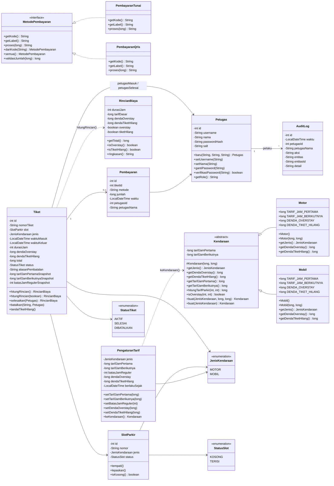
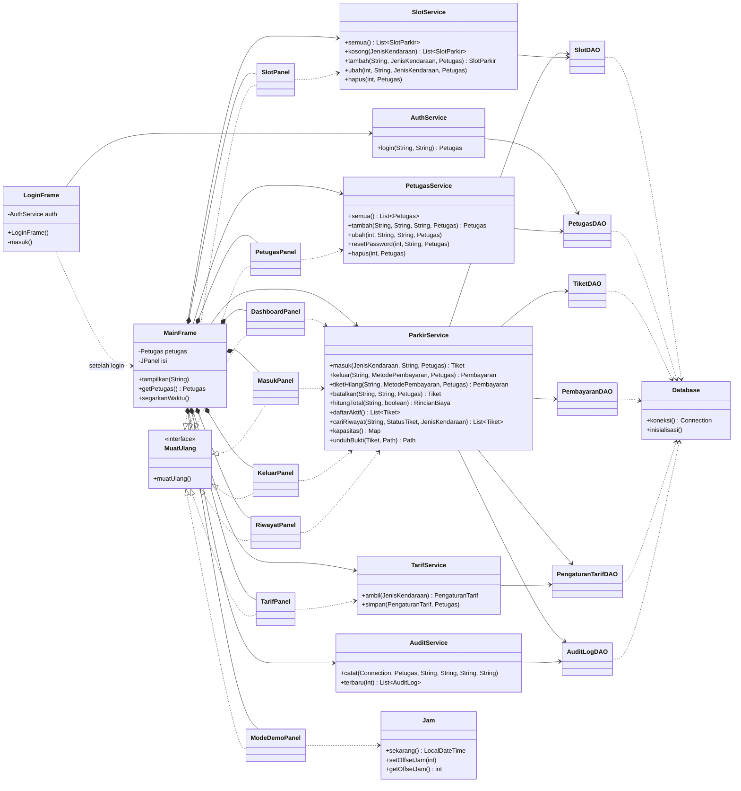
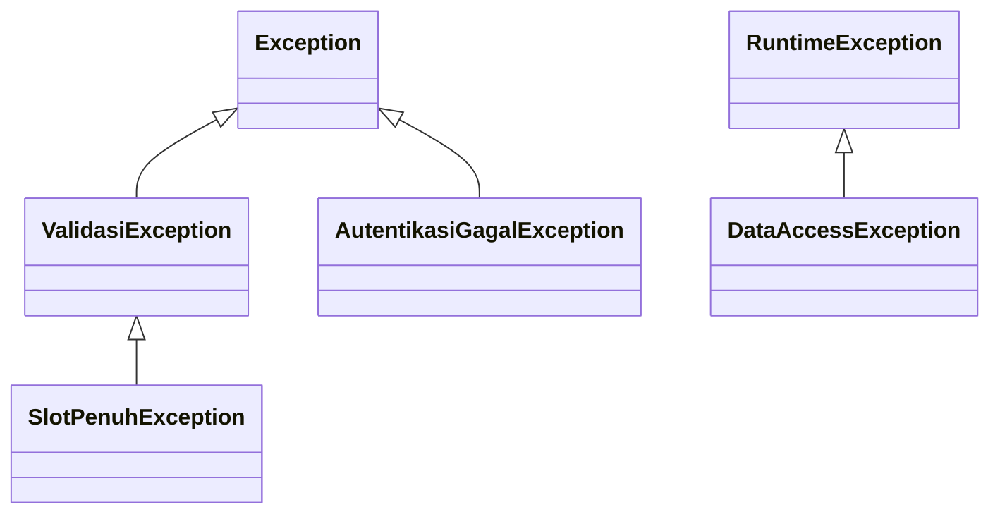

# Class Diagram — Eparking (ParkEase)

Diagram dibuat dengan [Mermaid](https://mermaid.js.org/) agar mudah dirawat:
GitHub merender blok di bawah secara otomatis. Untuk laporan Word/PDF, buka
[mermaid.live](https://mermaid.live), tempel satu blok, lalu ekspor sebagai
PNG atau SVG.

## 1. Model inti (pilar OOP)

Memuat hierarki `Kendaraan`, interface `MetodePembayaran`, serta entitas utama
beserta relasinya.

## 2. Arsitektur aplikasi (UI → Service → DAO → SQLite)

Menunjukkan pemisahan tampilan, logika bisnis, dan akses data, serta navigasi
`CardLayout` pada `MainFrame`.

## 3. Exception handling

## Catatan

- Diagram 1 memuat kelas model/logika (di luar kelas tampilan) dan menonjolkan
  pewarisan, abstract class, interface, serta relasi antarentitas.
- Diagram 2 menunjukkan alur dependensi dari tampilan ke service, DAO, sampai
  basis data SQLite lokal (`data/parkir.db`).
- Getter/setter rutin dan konstanta kecil tidak semuanya ditampilkan agar
  diagram tetap terbaca; method penting dan relasi antarkelas tetap lengkap.
